# Datamodel VHL-site

Dit document beschrijft de database van de VHL-site: welke tabellen er zijn, hoe ze samenhangen en welke regels de database zelf bewaakt. Je kunt het lezen zonder het project te kennen. Wat je over de league moet weten, staat in de eerste twee hoofdstukken.

- **Versie:** 15 november 2026
- **Database:** PostgreSQL 18, met migraties in Flyway
- **Al gebouwd:** `season`, `division`, `team` en `team_season` (migraties V1 en V2)
- **Nog ontwerp:** alle andere tabellen. Die kunnen nog veranderen tot hun migratie er is.

Inhoud:

1. [Het project in het kort](#het-project-in-het-kort)
2. [Begrippen](#begrippen)
3. [Zo lees je de diagrammen](#zo-lees-je-de-diagrammen)
4. [Ontwerpkeuzes](#ontwerpkeuzes)
5. [Overzicht](#overzicht)
6. [Tabellen per onderdeel](#tabellen-per-onderdeel)
7. [Statussen](#statussen)
8. [Regels in de database](#regels-in-de-database)
9. [Nog niet definitief](#nog-niet-definitief)

## Het project in het kort

De VolleyHub League (VHL) is een online competitie voor het pc-spel Just Volleyball, waarin teams 4 tegen 4 spelen. De VHL-site wordt de website van de league. Spelers loggen in met hun Discord-account, captains beheren hun team en plannen wedstrijden, en de staff van de league keurt wijzigingen en uitslagen goed. Bezoekers zien de stand.

Deze regels van de league bepalen het model:

| Regel van de league | Waar je het terugziet |
| --- | --- |
| De league speelt in seizoenen. Een seizoen heeft twee divisies: Division 1 met 8 teams en Division 2 met 10 teams. | `Season`, `Division` |
| De plek in de eindstand bepaalt wie kampioen wordt, promoveert of degradeert. | `ZoneRule` |
| Teams zonder plek in een divisie spelen in het Open Circuit. Zij verdienen punten in losse toernooien, de Open Cups. | `TeamSeason` zonder divisie; `OpenCup` en `CupPlacement` |
| Een speler zit in hoogstens één team. Een team heeft hoogstens 6 spelers, van wie 5 core-spelers. | `RosterEntry`, `CorePlayer` |
| De staff keurt elke wijziging in een roster goed voordat die ingaat. | `RosterRequest` |
| De captains van twee teams spreken per speelronde zelf een speeltijd af. | `Round`, `AllowedSlot`, `TimeProposal` |
| Een wedstrijd is best of 3. Een set gaat tot 20 punten. | `SetScore` |
| Beide captains vullen de uitslag in. Die telt pas als de staff hem goedkeurt. | `ResultSubmission`, `Match` |
| Komt een team niet opdagen, dan wint de tegenstander zonder score en krijgt het team een strafpunt. | `Match`, `PointAdjustment` |

## Begrippen

| Begrip | Betekenis |
| --- | --- |
| Staff | De mensen die de league leiden. Er zijn drie rollen: admin, moderator en referee. |
| Captain | De speler die een team beheert. Elk team heeft er precies één. Een co-captain helpt de captain en krijgt per taak rechten (release 2). |
| Roster | De spelers van een team. |
| Core-speler | Een van de 5 vaste spelers die een team per seizoen opgeeft. De andere spelers in het roster zijn substitutes. |
| Roster token | Elk team krijgt er 4 per seizoen. Een wijziging in het roster na de start van het seizoen kost tokens (release 2). |
| Transferwindow | Een periode waarin teams nieuwe spelers mogen aannemen (release 2). |
| Roster lock | Het moment in een seizoen waarna rosters vastliggen. |
| Speelronde | Een ronde van het schema. Elke wedstrijd uit de ronde moet binnen de periode van die ronde worden gespeeld. |
| Walkover | Een wedstrijd die een team wint omdat de tegenstander niet kwam opdagen. Er is geen score. |
| Zone | Wat een plek in de eindstand oplevert, zoals promotie of degradatie. |
| Open Circuit | De teams die in een seizoen niet in een divisie spelen. |
| Circuit Points | De punten die een team in het Open Circuit verdient met zijn eindplaats in een Open Cup. |

## Zo lees je de diagrammen

De diagrammen zijn ER-diagrammen met kraaienpootnotatie. Een lijn loopt van de tabel met de primaire sleutel naar de tabel met de verwijzing.

- `A ||--o{ B`: één A heeft nul of meer B's. B heeft een verplichte foreign key naar A.
- `A |o--o{ B`: hetzelfde, maar de foreign key in B mag leeg zijn.
- `A ||--o| B`: één A heeft hoogstens één B.
- `PK`, `FK` en `UK`: primaire sleutel, foreign key en unieke kolom.

Verder geldt:

- **Namen.** De diagrammen gebruiken de namen uit de code, zoals `TeamSeason`. In de database heet die tabel `team_season`. Kolomnamen zijn in het diagram en in de database gelijk.
- **Lege boxen.** Een tabel zonder kolommen hoort bij een ander onderdeel. Hij staat er alleen om de verbinding te laten zien.
- **Releases.** De site komt er in drie releases. Tabellen en kolommen die pas later nodig zijn, hebben de opmerking "release 2" of "release 3".
- **Sleutels.** De meeste tabellen hebben een `id` van het type `bigint` dat de database zelf uitdeelt. Tabellen die alleen twee andere koppelen of één andere aanvullen, zoals `CorePlayer` en `StaffRole`, gebruiken hun foreign keys als sleutel.
- **Vaste waarden.** Kolommen zoals `status` en `type` zijn tekst met een vaste lijst waarden. Die lijsten staan onder elk diagram.

## Ontwerpkeuzes

1. **Alles van een seizoen hangt aan `TeamSeason`.** Een team bestaat over seizoenen heen, maar zijn divisie, core-spelers, strafpunten en wedstrijden horen bij één seizoen. `TeamSeason` is één team in één seizoen. Zo overschrijft een nieuw seizoen niets van het vorige.
2. **Een speler zit via een `RosterEntry` in een team.** Die rij heeft een begin (`joined_at`) en een eind (`left_at`). Daardoor blijft de geschiedenis bewaard en kan de database afdwingen dat een speler in één team tegelijk zit.
3. **De stand is geen tabel.** De site berekent hem uit de goedgekeurde uitslagen, de walkovers en de puntenaanpassingen. Er kan dus geen stand bestaan die niet klopt met de uitslagen.
4. **De regels van een seizoen zijn kolommen van `Season`.** Denk aan de punten per uitslag en de grootte van een roster. De league kan ze per seizoen aanpassen zonder dat de code verandert.
5. **Tijden zijn `timestamptz`.** De database bewaart ze in UTC. De site toont ze in de tijdzone van de speler.
6. **Het aantal tokens dat een team over heeft, staat nergens.** De site berekent het: `Season.tokens_per_team` min de `token_cost` van alle goedgekeurde aanvragen en transfers van die `TeamSeason`.

## Overzicht

De belangrijkste tabellen van release 1, zonder kolommen. Begin bij `TeamSeason`, één team in één seizoen. Daarboven staat de competitie, rechts staan de teams met hun spelers en onderaan de wedstrijden.

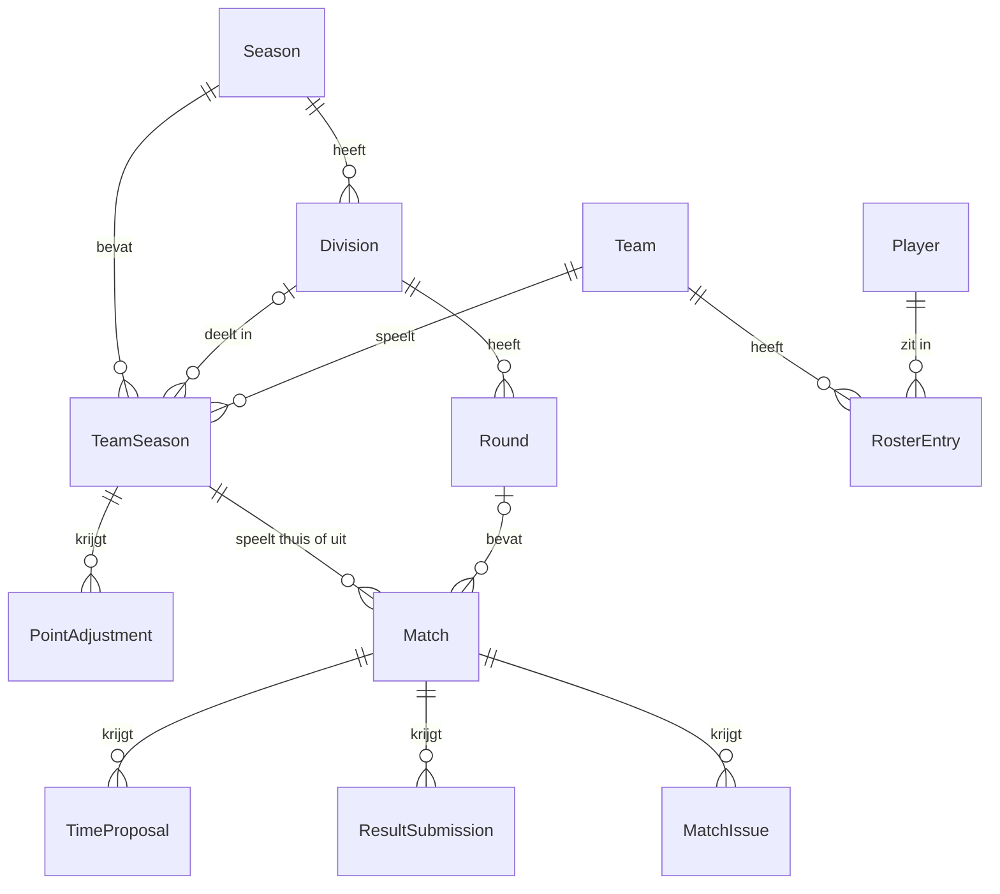

Niet in dit overzicht, wel verderop: `RosterRequest`, `StaffRole`, `AuditLog`, `ZoneRule`, `CorePlayer`, `AllowedSlot`, `SetScore`, `LineupEntry` en de tabellen van release 2.

## Tabellen per onderdeel

| Nr. | Onderdeel | Tabellen | Release | Gebouwd |
| --- | --- | --- | --- | --- |
| 1 | Seizoenen en divisies | `Season`, `Division`, `ZoneRule` | 1 | `Season` en `Division` |
| 2 | Teams per seizoen | `Team`, `TeamSeason`, `CorePlayer`, `PointAdjustment` | 1 | `Team` en `TeamSeason` |
| 3 | Rosters | `RosterEntry`, `RosterRequest` | 1 | nee |
| 4 | Spelers, staff en auditlog | `Player`, `StaffRole`, `AuditLog` | 1 | nee |
| 5 | Speelrondes en inplannen | `Round`, `AllowedSlot`, `Match`, `TimeProposal` | 1 | nee |
| 6 | Uitslagen en problemen | `ResultSubmission`, `SetScore`, `LineupEntry`, `MatchIssue` | 1 | nee |
| 7 | Transfers | `TransferWindow`, `TransferRequest` | 2 | nee |
| 8 | Statistieken en Open Cups | `PlayerStat`, `OpenCup`, `CupPlacement` | 2 | nee |

### 1. Seizoenen en divisies

Een seizoen legt de regels vast die dat seizoen gelden. Een divisie hoort bij één seizoen; een nieuw seizoen krijgt dus nieuwe divisies. `ZoneRule` zegt wat een plek in de eindstand van een divisie oplevert.

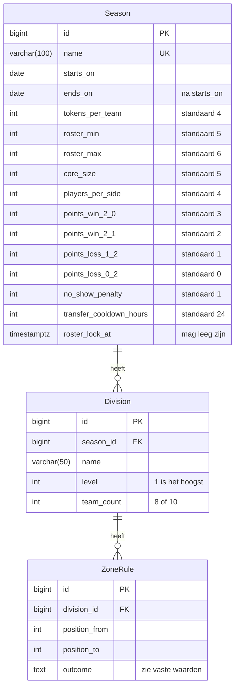

Vaste waarden van `ZoneRule.outcome`, met de indeling van het eerste seizoen als voorbeeld:

| Waarde | Betekenis | Division 1 | Division 2 |
| --- | --- | --- | --- |
| `CHAMPION` | Kampioen van de league | plek 1 | |
| `PROMOTION` | Promoveert naar Division 1 | | plek 1 |
| `PLAYOFF` | Speelt de promotieplayoff | plek 7 | plek 2 |
| `STAYS` | Blijft in de divisie | plek 2–6 | plek 3–8 |
| `QUALIFIER` | Speelt de D2 Qualifier, samen met de beste teams uit het Open Circuit | | plek 9–10 |
| `RELEGATION` | Degradeert naar Division 2 | plek 8 | |

### 2. Teams per seizoen

`Team` bewaart alleen wat altijd geldt, zoals de naam. Schrijft een team zich in voor een seizoen, dan komt er een rij in `TeamSeason`. Is `division_id` leeg, dan speelt het team dat seizoen in het Open Circuit. `PointAdjustment` is een correctie op de stand, zoals het strafpunt na een no-show.

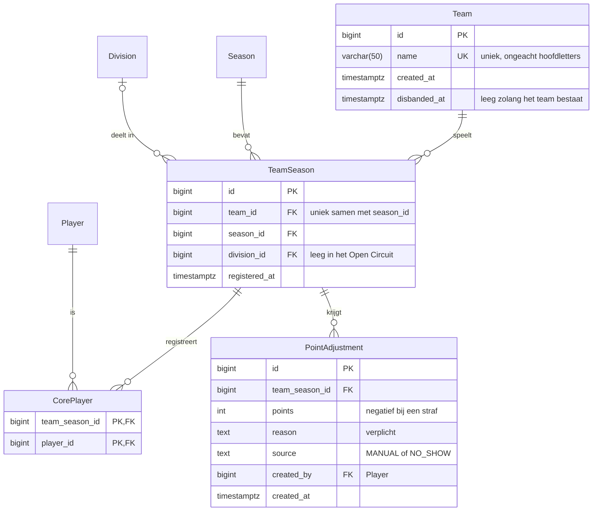

### 3. Rosters

`RosterEntry` is een plek in een team: wie, in welk team, in welke rol en van wanneer tot wanneer. Een plek ontstaat pas als de staff een `RosterRequest` goedkeurt. Een speler die vertrekt, houdt zijn rij; alleen `left_at` wordt gevuld.

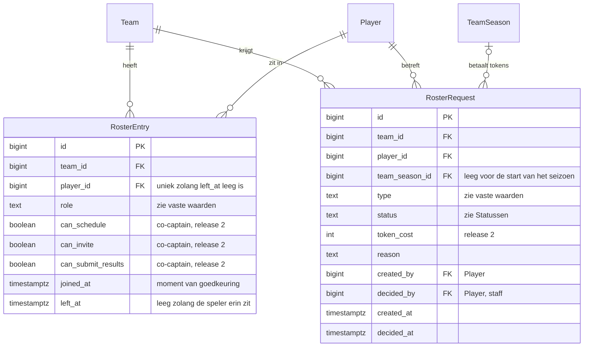

| Kolom | Waarden |
| --- | --- |
| `RosterEntry.role` | `CAPTAIN`, `CO_CAPTAIN` (release 2), `PLAYER` |
| `RosterRequest.type` | `INVITE`: de captain nodigt een speler uit. `JOIN_REQUEST`: een speler vraagt om een plek (release 2). `REMOVAL`: de captain verwijdert een speler. `LEAVE`: een speler vertrekt. `EMERGENCY`: noodvervanging (release 2). |

### 4. Spelers, staff en auditlog

Een `Player` ontstaat bij de eerste keer inloggen met Discord. De site bewaart alleen het Discord-ID, de naam en de avatar. Een staffrol is een aparte rij, zodat de meeste spelers er geen hebben. `AuditLog` legt vast wie wat wanneer heeft gewijzigd. Die tabel verwijst met `entity_type` en `entity_id` naar elke andere tabel en heeft daarom geen foreign key naar die tabellen.

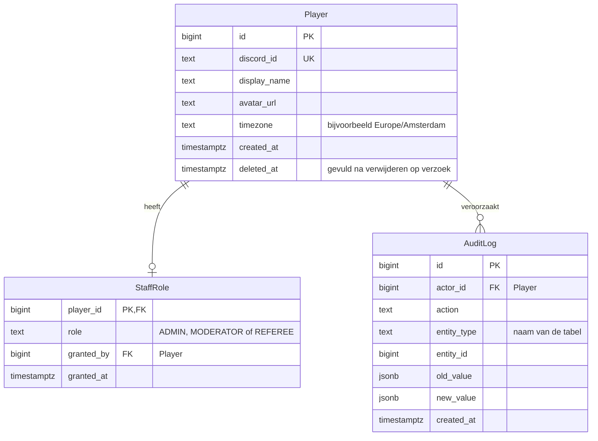

### 5. Speelrondes en inplannen

Een divisie heeft speelrondes. Een `Round` heeft een periode en een lijst toegestane tijden (`AllowedSlot`). Een `Match` is een wedstrijd tussen twee teams in hetzelfde seizoen; daarom verwijst hij naar `TeamSeason` en niet naar `Team`. De captains doen tijdvoorstellen tot er één is geaccepteerd. Dan komt die tijd in `Match.scheduled_at`.

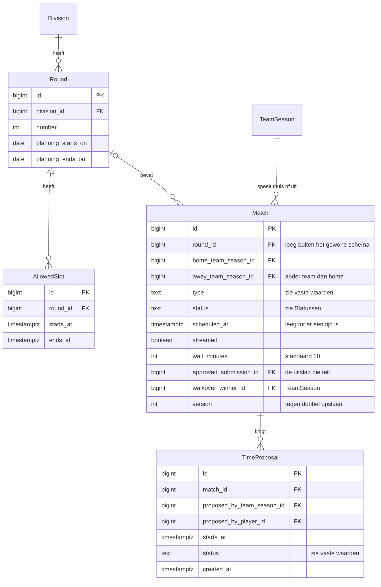

| Kolom | Waarden |
| --- | --- |
| `Match.type` | `REGULAR`: wedstrijd uit het schema. `TIEBREAKER`, `PLAYOFF` en `QUALIFIER`: losse wedstrijden aan het eind van het seizoen (release 3). |
| `TimeProposal.status` | `OPEN`, `ACCEPTED`, `DECLINED`, of `SUPERSEDED` als er een nieuwer voorstel is. |

Twee kolommen van `Match` vragen uitleg:

- `wait_minutes` is hoe lang een team op de tegenstander moet wachten voordat het een no-show mag melden.
- `version` is een teller die bij elke wijziging omhoog gaat. Proberen twee captains tegelijk dezelfde wedstrijd te wijzigen, dan wordt de tweede geweigerd (optimistic locking).

### 6. Uitslagen en problemen

Elke captain dient een eigen `ResultSubmission` in, met de stand per set en de spelers die meededen. Zijn de twee gelijk, dan keurt de staff er één goed en wijst `Match.approved_submission_id` naar die uitslag. Verschillen ze, dan komt er een `MatchIssue` en beslist de staff. De staff kan ook zelf een uitslag invullen.

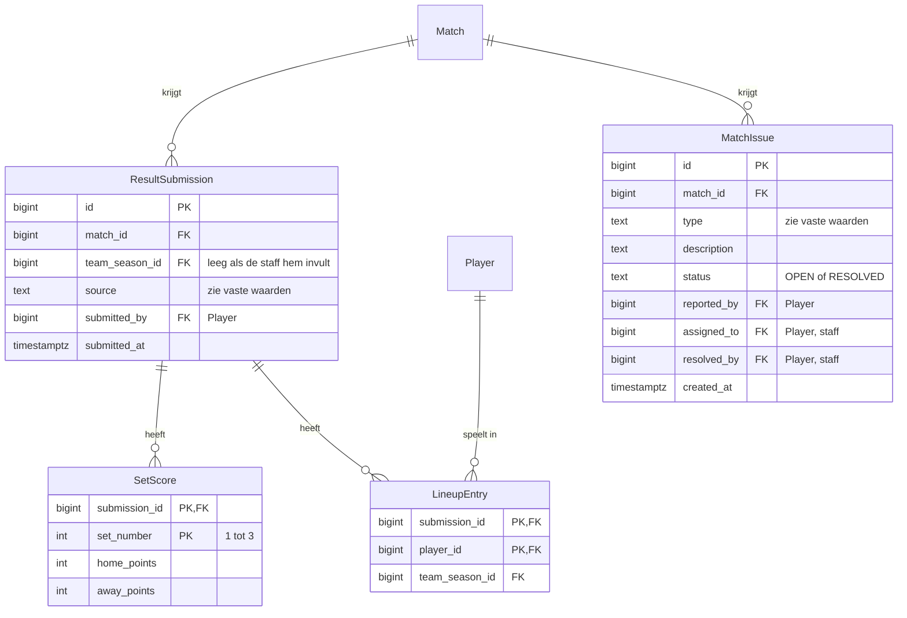

| Kolom | Waarden |
| --- | --- |
| `ResultSubmission.source` | `HOME_CAPTAIN`, `AWAY_CAPTAIN`, `STAFF` |
| `MatchIssue.type` | `MISMATCH`: de twee uitslagen verschillen. `NO_SHOW`: een team kwam niet opdagen. `PROBLEM`: een ander probleem dat een captain meldt (release 2). |

### 7. Transfers (release 2)

Een transfer verplaatst een speler van het ene team naar het andere. Dat mag alleen in een transferwindow, en de speler, beide captains en de staff moeten akkoord gaan. De tijdstippen van elk akkoord staan in de aanvraag zelf.

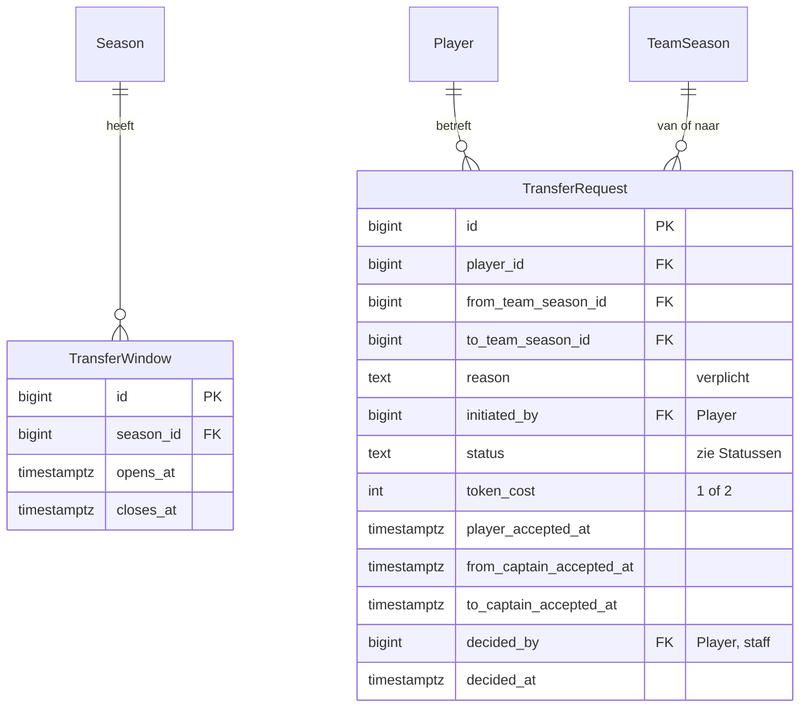

### 8. Statistieken en Open Cups (release 2)

`PlayerStat` bevat de cijfers van één speler in één wedstrijd; een admin voert ze in. Een Open Cup is een los toernooi voor teams uit het Open Circuit. De wedstrijden daarvan lopen in een extern programma. De site bewaart alleen de eindplaats van elk team en de Circuit Points die daarbij horen.

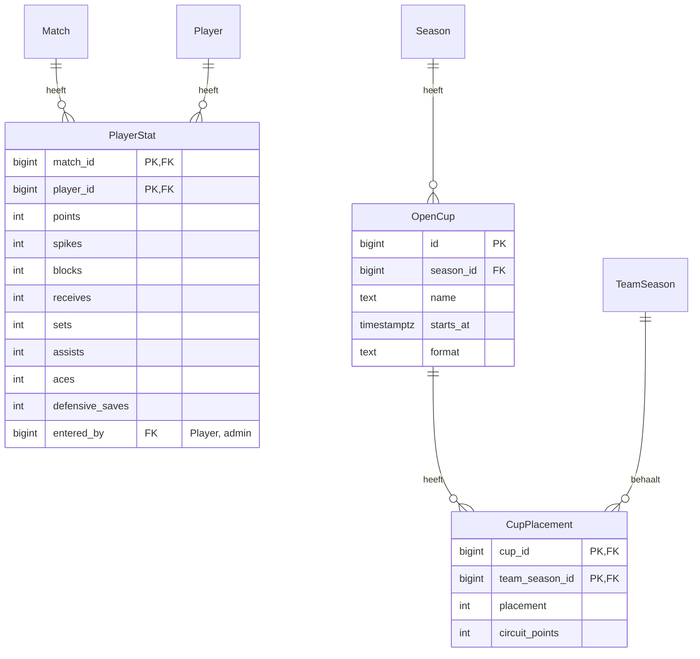

## Statussen

Drie tabellen hebben een status die in vaste stappen verandert.

### Wedstrijd (`Match.status`)

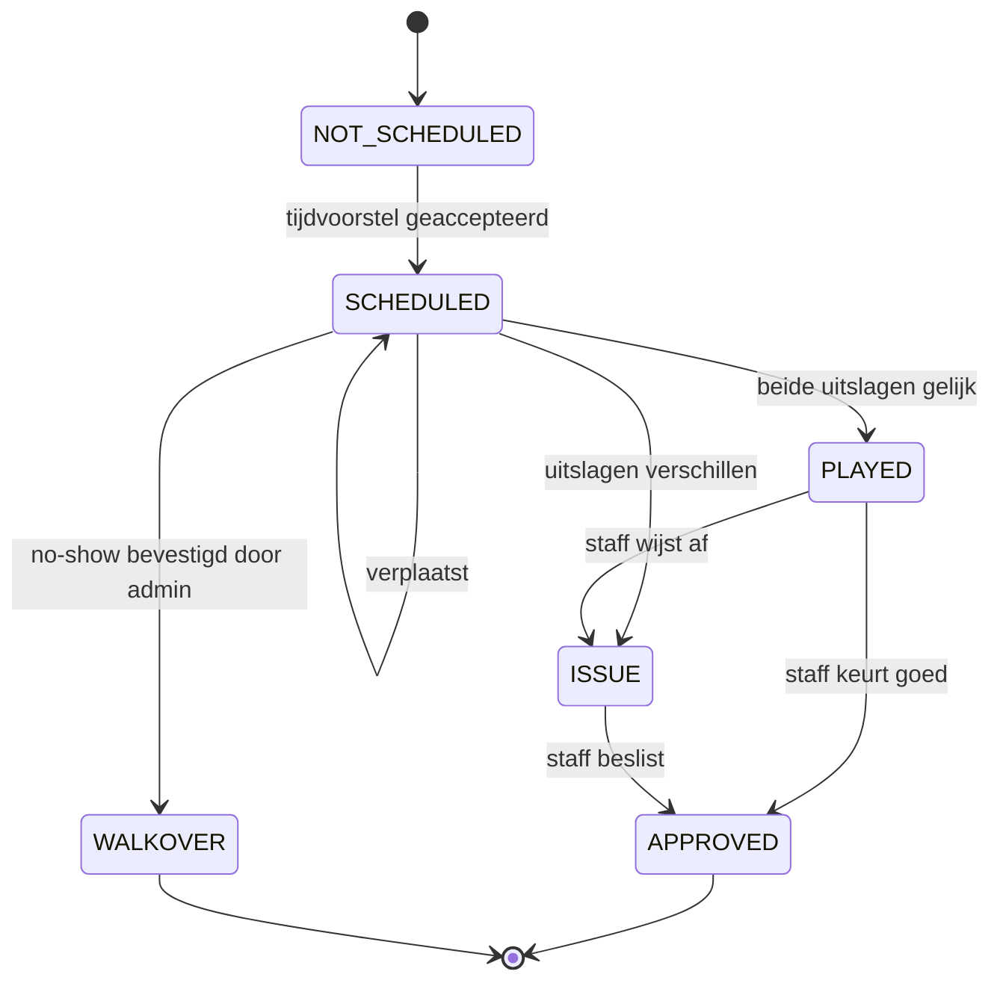

| Status | Betekenis |
| --- | --- |
| `NOT_SCHEDULED` | De wedstrijd bestaat, maar er is nog geen tijd afgesproken. Dat blijft zo als de periode van de speelronde voorbij is. |
| `SCHEDULED` | Er is een tijd afgesproken. |
| `PLAYED` | Beide captains hebben dezelfde uitslag ingediend. |
| `ISSUE` | De uitslagen verschillen, of de staff heeft de uitslag afgewezen. De staff moet beslissen. |
| `APPROVED` | De uitslag is goedgekeurd en telt mee in de stand. |
| `WALKOVER` | Een team kwam niet opdagen. De tegenstander wint zonder score. |

### Rosterwijziging (`RosterRequest.status`)

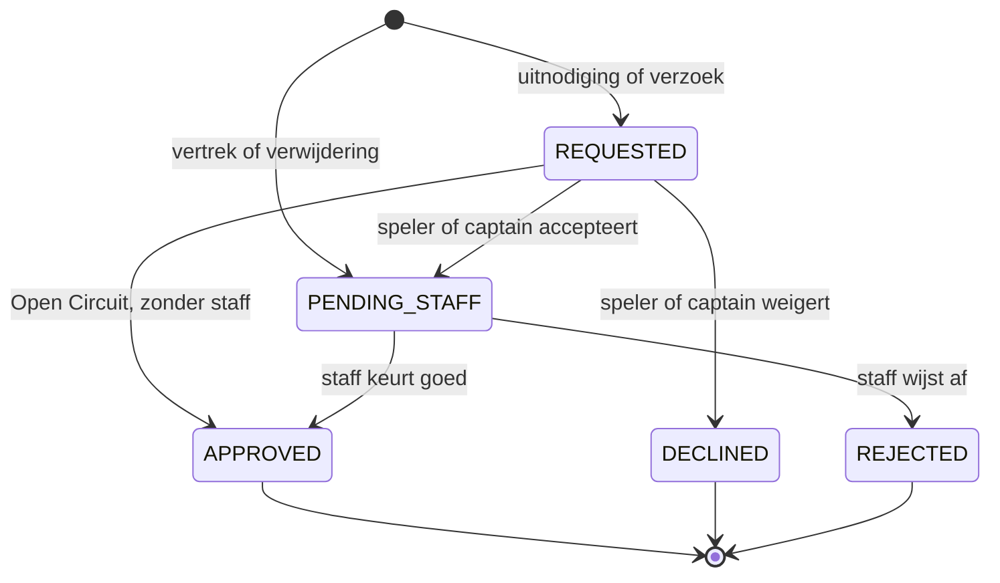

| Status | Betekenis |
| --- | --- |
| `REQUESTED` | De aanvraag wacht op het antwoord van de speler of de captain. |
| `PENDING_STAFF` | De aanvraag wacht op de staff. |
| `APPROVED` | Goedgekeurd. Het roster is aangepast. |
| `DECLINED` | De speler of de captain heeft geweigerd. |
| `REJECTED` | De staff heeft de aanvraag afgewezen. |

Teams in het Open Circuit hebben geen goedkeuring van de staff nodig.

### Transfer (`TransferRequest.status`, release 2)

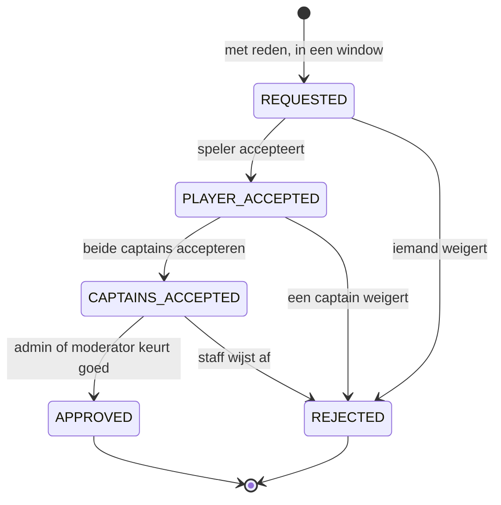

Vraagt de speler de transfer zelf aan, dan begint de aanvraag in `PLAYER_ACCEPTED`.

## Regels in de database

Deze regels bewaakt de database zelf, met een constraint of een index. Een fout in de code kan ze dus niet breken.

| Regel | Hoe | Migratie |
| --- | --- | --- |
| Een seizoensnaam komt één keer voor | `UNIQUE (name)` op `season` | V1 |
| Een seizoen eindigt na het begin | `CHECK (ends_on > starts_on)` op `season` | V1 |
| Het minimum van een roster is niet groter dan het maximum | `CHECK (roster_min <= roster_max)` op `season` | V1 |
| Er zijn niet meer core-spelers dan plekken in het roster | `CHECK (core_size <= roster_max)` op `season` | V1 |
| Aantallen zijn niet negatief of onzinnig | `CHECK` op `tokens_per_team >= 0`, `level >= 1` en `team_count >= 2` | V1 |
| Een niveau komt per seizoen één keer voor | `UNIQUE (season_id, level)` op `division` | V1 |
| Teamnamen zijn uniek, ongeacht hoofdletters | `UNIQUE INDEX ON team (lower(name))` | V2 |
| Een team staat één keer in een seizoen | `UNIQUE (team_id, season_id)` op `team_season` | V2 |
| Een Discord-account hoort bij één speler | `UNIQUE (discord_id)` op `player` | later |
| Een speler zit in hoogstens één team | `UNIQUE INDEX ON roster_entry (player_id) WHERE left_at IS NULL` | later |
| Een team heeft één captain | `UNIQUE INDEX ON roster_entry (team_id) WHERE role = 'CAPTAIN' AND left_at IS NULL` | later |
| Een wedstrijd heeft twee verschillende teams | `CHECK (home_team_season_id <> away_team_season_id)` op `match` | later |
| Elk team dient per wedstrijd één uitslag in | `UNIQUE INDEX ON result_submission (match_id, team_season_id) WHERE team_season_id IS NOT NULL` | later |
| Een puntenaanpassing heeft een reden | `reason text NOT NULL` op `point_adjustment` | later |

Deze regels kan een constraint niet uitdrukken. De code controleert ze, en tests bewijzen dat ze ook gelden als twee aanvragen tegelijk binnenkomen:

- een roster heeft hoogstens `Season.roster_max` spelers en precies `Season.core_size` core-spelers;
- twee captains die tegelijk dezelfde wedstrijd wijzigen, overschrijven elkaar niet (kolom `version` op `match`);
- een team kan niet meer tokens uitgeven dan het heeft (release 2);
- een nieuwe speler komt er alleen bij in een open transferwindow en mag pas 24 uur na de goedkeuring spelen (release 2).

## Nog niet definitief

- **Punten per uitslag.** De standaardwaarden in `Season` (3, 2, 1 en 0 punten) zijn een voorstel. De league beslist nog.
- **Circuit Points per eindplaats.** De league heeft die nog niet vastgesteld.
- **Verwijderen van een speler.** `Player.deleted_at` markeert dat een speler om verwijdering heeft gevraagd. Welke gegevens dan worden gewist, is nog niet uitgewerkt.
- **Technische tabellen.** Tabellen die een framework nodig heeft, zoals die voor sessies, horen niet bij het domein en staan hier niet in.
