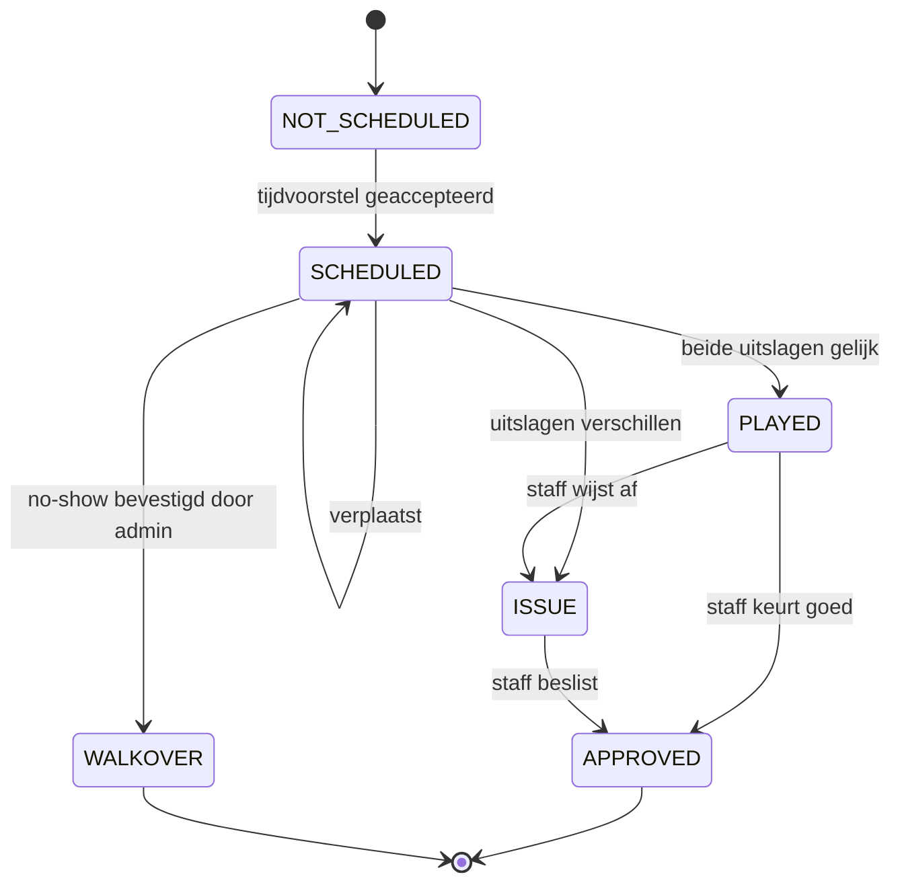
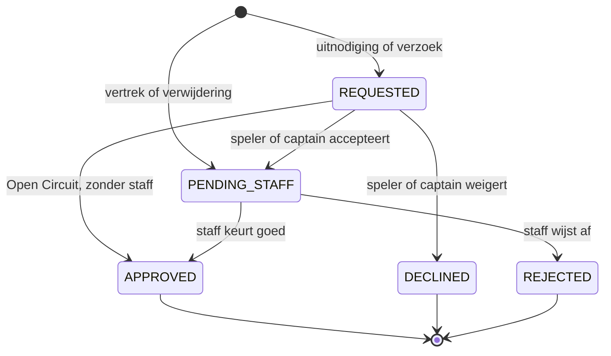
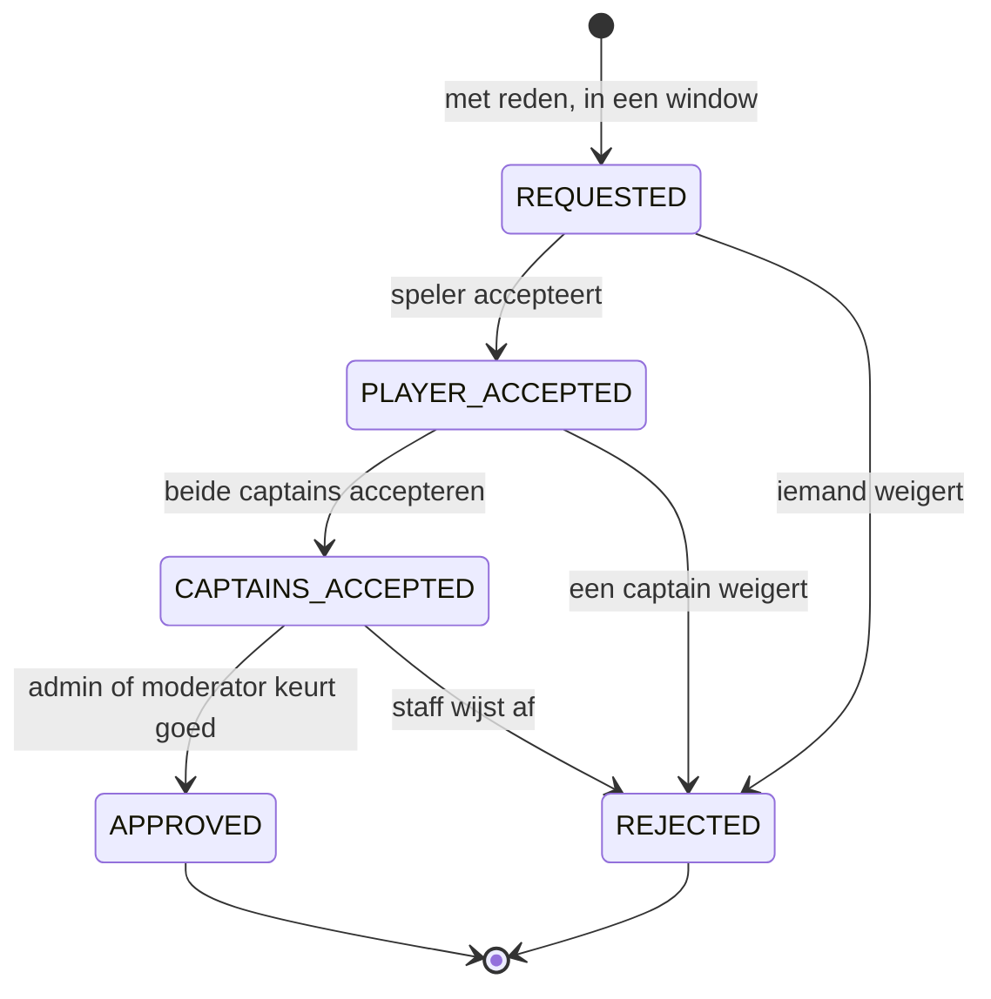

# Datamodel VHL-site

Eerste versie, gebaseerd op de user stories (8 november 2026). Werk dit bestand bij met elke Flyway-migratie die het model verandert.

Uitgangspunten:

- Een speler zit nooit direct in een team, maar via een `RosterEntry` met `joined_at` en `left_at`. Daarop rusten de cooldown van 24 uur, de speelgerechtigdheid en de goedkeuring door staff.
- Een team bestaat over seizoenen heen. Alles wat bij één seizoen hoort (divisie, core-spelers, tokens, strafpunten, wedstrijden) hangt aan `TeamSeason`.
- De stand is geen tabel. Die bereken je uit de goedgekeurde uitslagen (`Match.approved_submission_id`), walkovers en `PointAdjustment`.
- Alle tijden zijn `timestamptz` en worden als UTC opgeslagen. De site toont ze in de tijdzone van de speler.
- Tokens die een team nog heeft, bereken je: `Season.tokens_per_team` min de `token_cost` van goedgekeurde aanvragen en transfers voor die `TeamSeason`.

## Entiteiten en relaties

Entiteiten met (R2) komen in release 2.

```mermaid
erDiagram
    Player ||--o| StaffRole : "heeft"
    Player ||--o{ RosterEntry : "heeft"
    Team ||--o{ RosterEntry : "heeft"
    Team ||--o{ RosterRequest : "krijgt"
    Player ||--o{ RosterRequest : "betreft"
    Team ||--o{ TeamSeason : "speelt"
    Season ||--o{ TeamSeason : "bevat"
    Season ||--o{ Division : "heeft"
    Division |o--o{ TeamSeason : "deelt in"
    Division ||--o{ ZoneRule : "heeft"
    TeamSeason ||--o{ CorePlayer : "registreert"
    Player ||--o{ CorePlayer : "is"
    TeamSeason ||--o{ PointAdjustment : "krijgt"
    TeamSeason |o--o{ RosterRequest : "betaalt tokens"
    Division ||--o{ Round : "heeft"
    Round ||--o{ AllowedSlot : "heeft"
    Round |o--o{ Match : "bevat"
    TeamSeason ||--o{ Match : "speelt thuis of uit"
    Match ||--o{ TimeProposal : "krijgt"
    Match ||--o{ ResultSubmission : "krijgt"
    ResultSubmission ||--o{ SetScore : "heeft"
    ResultSubmission ||--o{ LineupEntry : "heeft"
    Player ||--o{ LineupEntry : "speelt in"
    Match ||--o{ MatchIssue : "krijgt"
    Player ||--o{ AuditLog : "veroorzaakt"
    Season ||--o{ TransferWindow : "heeft (R2)"
    Player ||--o{ TransferRequest : "betreft (R2)"
    TeamSeason ||--o{ TransferRequest : "van of naar (R2)"
    Match ||--o{ PlayerStat : "heeft (R2)"
    Player ||--o{ PlayerStat : "heeft (R2)"
    Season ||--o{ OpenCup : "heeft (R2)"
    OpenCup ||--o{ CupPlacement : "heeft (R2)"
    TeamSeason ||--o{ CupPlacement : "behaalt (R2)"

    Player {
        bigint id PK
        text discord_id UK "uniek"
        text display_name
        text avatar_url
        text timezone "bijv. Europe/Amsterdam"
        timestamptz created_at
        timestamptz deleted_at "AVG: verwijderd op verzoek"
    }
    StaffRole {
        bigint player_id PK, FK
        text role "ADMIN, MODERATOR, REFEREE"
        bigint granted_by FK
        timestamptz granted_at
    }
    Team {
        bigint id PK
        text name UK "uniek, hoofdletterongevoelig"
        timestamptz created_at
        timestamptz disbanded_at
    }
    RosterEntry {
        bigint id PK
        bigint team_id FK
        bigint player_id FK "uniek zolang left_at leeg is"
        text role "CAPTAIN, CO_CAPTAIN, PLAYER"
        boolean can_schedule "alleen co-captain"
        boolean can_invite "alleen co-captain"
        boolean can_submit_results "alleen co-captain"
        timestamptz joined_at "na goedkeuring door staff"
        timestamptz left_at
    }
    RosterRequest {
        bigint id PK
        bigint team_id FK
        bigint player_id FK
        bigint team_season_id FK "voor de tokens, leeg voor de start"
        text type "INVITE, JOIN_REQUEST, REMOVAL, LEAVE, EMERGENCY"
        text status "REQUESTED, PENDING_STAFF, APPROVED, DECLINED, REJECTED"
        int token_cost
        text reason
        bigint created_by FK
        bigint decided_by FK
        timestamptz created_at
        timestamptz decided_at
    }
    Season {
        bigint id PK
        text name
        date starts_on
        date ends_on
        int tokens_per_team "standaard 4"
        int roster_min "standaard 5"
        int roster_max "standaard 6"
        int core_size "standaard 5"
        int players_per_side "standaard 4"
        int points_win_2_0
        int points_win_2_1
        int points_loss_1_2
        int points_loss_0_2
        int no_show_penalty "standaard 1"
        int transfer_cooldown_hours "standaard 24"
        timestamptz roster_lock_at
    }
    Division {
        bigint id PK
        bigint season_id FK
        text name "Division 1, Division 2"
        int level "1 is het hoogst"
        int team_count "8 of 10"
    }
    ZoneRule {
        bigint id PK
        bigint division_id FK
        int position_from
        int position_to
        text outcome "CHAMPION, PROMOTION, PLAYOFF, STAYS, QUALIFIER, RELEGATION"
    }
    TeamSeason {
        bigint id PK
        bigint team_id FK "uniek samen met season_id"
        bigint season_id FK
        bigint division_id FK "leeg voor het Open Circuit"
        timestamptz registered_at
    }
    CorePlayer {
        bigint team_season_id PK, FK
        bigint player_id PK, FK
    }
    PointAdjustment {
        bigint id PK
        bigint team_season_id FK
        int points "negatief bij een straf"
        text reason "verplicht"
        text source "MANUAL, NO_SHOW"
        bigint created_by FK
        timestamptz created_at
    }
    Round {
        bigint id PK
        bigint division_id FK
        int number
        date planning_starts_on
        date planning_ends_on
    }
    AllowedSlot {
        bigint id PK
        bigint round_id FK
        timestamptz starts_at
        timestamptz ends_at
    }
    Match {
        bigint id PK
        bigint round_id FK "leeg bij playoff, qualifier of tiebreaker"
        bigint home_team_season_id FK
        bigint away_team_season_id FK "niet gelijk aan home"
        text type "REGULAR, TIEBREAKER, PLAYOFF, QUALIFIER"
        text status "NOT_SCHEDULED, SCHEDULED, PLAYED, ISSUE, APPROVED, WALKOVER"
        timestamptz scheduled_at
        boolean streamed
        int wait_minutes "standaard 10"
        bigint approved_submission_id FK "de uitslag die telt"
        bigint walkover_winner_id FK
        int version "optimistic locking"
    }
    TimeProposal {
        bigint id PK
        bigint match_id FK
        bigint proposed_by_team_season_id FK
        bigint proposed_by_player_id FK
        timestamptz starts_at
        text status "OPEN, ACCEPTED, DECLINED, SUPERSEDED"
        timestamptz created_at
    }
    ResultSubmission {
        bigint id PK
        bigint match_id FK
        bigint team_season_id FK "leeg als staff hem invult"
        text source "HOME_CAPTAIN, AWAY_CAPTAIN, STAFF"
        bigint submitted_by FK
        timestamptz submitted_at
    }
    SetScore {
        bigint submission_id PK, FK
        int set_number PK "1 tot 3"
        int home_points
        int away_points
    }
    LineupEntry {
        bigint submission_id PK, FK
        bigint player_id PK, FK
        bigint team_season_id FK
    }
    MatchIssue {
        bigint id PK
        bigint match_id FK
        text type "PROBLEM, NO_SHOW, MISMATCH"
        text description
        text status "OPEN, RESOLVED"
        bigint reported_by FK
        bigint assigned_to FK
        bigint resolved_by FK
        timestamptz created_at
    }
    AuditLog {
        bigint id PK
        bigint actor_id FK
        text action
        text entity_type
        bigint entity_id
        jsonb old_value
        jsonb new_value
        timestamptz created_at
    }
    TransferWindow {
        bigint id PK
        bigint season_id FK
        timestamptz opens_at
        timestamptz closes_at
    }
    TransferRequest {
        bigint id PK
        bigint player_id FK
        bigint from_team_season_id FK
        bigint to_team_season_id FK
        text reason "verplicht"
        bigint initiated_by FK
        text status "REQUESTED, PLAYER_ACCEPTED, CAPTAINS_ACCEPTED, APPROVED, REJECTED"
        int token_cost "1 of 2"
        timestamptz player_accepted_at
        timestamptz from_captain_accepted_at
        timestamptz to_captain_accepted_at
        bigint decided_by FK
        timestamptz decided_at
    }
    PlayerStat {
        bigint match_id PK, FK
        bigint player_id PK, FK
        int points
        int spikes
        int blocks
        int receives
        int sets
        int assists
        int aces
        int defensive_saves
        bigint entered_by FK "alleen admin"
    }
    OpenCup {
        bigint id PK
        bigint season_id FK
        text name
        timestamptz starts_at
        text format
    }
    CupPlacement {
        bigint cup_id PK, FK
        bigint team_season_id PK, FK
        int placement
        int circuit_points
    }
```

## Statussen

### Wedstrijd (`Match.status`)

Na de deadline blijft een wedstrijd `NOT_SCHEDULED`, maar komt hij op het admin-dashboard.

### Rosterwijziging (`RosterRequest.status`)

### Transfer (`TransferRequest.status`, release 2)

Startte de speler de transfer zelf, dan begint hij in `PLAYER_ACCEPTED`.

## Regels in de database

| Regel | Constraint |
| --- | --- |
| Een Discord-account hoort bij één speler | `UNIQUE (discord_id)` op `player` |
| Een speler zit in maximaal één team | `CREATE UNIQUE INDEX ... ON roster_entry (player_id) WHERE left_at IS NULL` |
| Eén captain per team | `CREATE UNIQUE INDEX ... ON roster_entry (team_id) WHERE role = 'CAPTAIN' AND left_at IS NULL` |
| Teamnamen zijn uniek | `CREATE UNIQUE INDEX ... ON team (lower(name))` |
| Een team staat één keer in een seizoen | `UNIQUE (team_id, season_id)` op `team_season` |
| Een wedstrijd heeft twee verschillende teams | `CHECK (home_team_season_id <> away_team_season_id)` op `match` |
| Twee captains overschrijven elkaar niet | kolom `version` op `match`, met `@Version` in JPA |
| Elk team dient per wedstrijd één uitslag in | `CREATE UNIQUE INDEX ... ON result_submission (match_id, team_season_id) WHERE team_season_id IS NOT NULL` |
| Een puntenaanpassing heeft een reden | `reason text NOT NULL` op `point_adjustment` |

In de service, met een test voor gelijktijdige aanvragen:

- maximaal `Season.roster_max` spelers en precies `Season.core_size` core-spelers;
- een nieuwe speler alleen in een open transferwindow, en speelgerechtigd 24 uur na goedkeuring;
- genoeg tokens over voordat staff een aanvraag goedkeurt.
